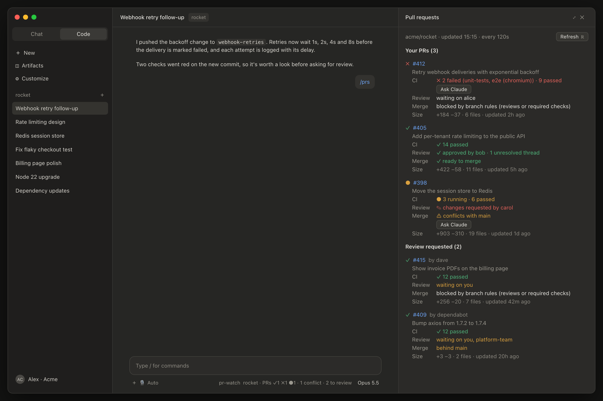

# pr-watch

A Claude Code mod that keeps an eye on the GitHub pull requests of the repo you're working in: your own PRs and the ones waiting on your review.



<sub>Illustration with sample data (`acme/rocket`): the `/prs` pane on the right and the status line under the prompt.</sub>

## What it does

- **Status line.** A summary that is always visible under the prompt: `rocket · PRs ✓1 ✗1 ●1 · 1 conflict · 2 to review`. ✓ means passing CI, ✗ failing, ● running.
- **Toasts when something changes.** It notifies you when:
  - CI goes red, or goes green again
  - a PR is approved or has changes requested
  - a merge conflict appears
  - a new review request arrives
  - one of your PRs is merged or closed

  The first check in a session only records a starting point, so opening a session doesn't produce a burst of toasts.
- **`/prs` pane.** It lists your PRs and your review requests, each with:
  - **CI:** passed, failed, running and skipped counts, plus the names of the failing checks
  - **Review:** who approved, who requested changes, who is still requested (`you` when it's you), and unresolved threads
  - **Merge:** ready to merge, conflicts, behind the base branch, blocked by branch rules, or draft
  - **Size:** additions and deletions, files changed, and when the PR was last updated

  Press **Refresh** (`r`) to check right away.
- **Ask Claude.** Your own PRs get buttons that hand Claude a prompt about the problem. Claude is told not to push or change the PR without asking you first.
  - **In the desktop app,** the button opens a **new Claude Code session in the same folder** with the prompt already in its composer. Your current conversation is left alone, and nothing runs until you send the prompt there.
  - **In a terminal,** or if the desktop app can't be opened, the prompt is queued in the current conversation and starts once it's idle.
  - **Failing CI:** **Ask Claude** has Claude read the failing logs with `gh` and propose a fix.
  - **Merge conflict or behind main:** **Ask Claude** has Claude look into the problem and choose the fix itself. It picks between merging main in, rebasing onto main, or GitHub's update-branch (when the PR is only behind), and tells you which it chose and why. It weighs the repo's conventions, branch protection, and existing reviews that a force-push would disrupt. If a PR that's only behind doesn't need updating, Claude says so and stops. Claude works on the branch in a separate git worktree, so your current checkout is left alone, and it runs the tests and type-check. For conflicts, it shows you how it resolved each file.
- **Merge.** Your approved PRs that GitHub would merge right now get a merge button, labeled like GitHub's own (**Squash and merge**, **Merge**, or **Rebase and merge**, whichever GitHub preselects for you in that repo).
  - "Right now" means CI is not failing or running, there's no conflict, the PR is not a draft, and branch rules don't block it.
  - Pressing it only asks: *Squash and merge #405 into main? [Confirm] [Cancel]*. Nothing merges until you press **Confirm**.
  - The merge is pinned to the head commit the pane showed, so GitHub refuses it if someone pushed after the pane last loaded.
  - It runs by repo name, so it doesn't touch your local checkout or branches. Deleting the branch follows the repo's own setting, as on GitHub.
  - A toast says it merged, or gives GitHub's reason if it refused.
- **Follows the session's repo.** It reads the `origin` remote of the session's folder, so each session shows its own repo. Folders that aren't on github.com get no status line.

## Requirements

- **Claude Code with mod (function hook) support.** Tested with 2.1.293. Older builds such as 2.1.176 don't load it.
- **GitHub CLI.** [`gh`](https://cli.github.com/) must be installed and logged in (`gh auth login`) with the `repo` scope.
- **A github.com remote.** The repo needs an `origin` remote on github.com. GitHub Enterprise hosts aren't supported yet.

## Install

Run this in a **terminal** Claude Code session:

```
/plugin install pr-watch --marketplace ngxuanbminh/pr-watch
```

1. Answer `y` to add the marketplace.
2. Choose the **user** scope, so the mod works in every project.
3. Optionally set the poll interval.

The mod is active right away and loads in every session you start afterwards. That includes the desktop app's Code tab, which doesn't have the `/plugin` command itself.

### Without the plugin manager

Clone the repo and point Claude Code at the folder in `~/.claude/settings.json`:

```bash
git clone https://github.com/ngxuanbminh/pr-watch ~/.claude/mods/pr-watch
```

```json
{
  "env": {
    "CLAUDE_CODE_PLUGIN_DIRS": "~/.claude/mods/pr-watch"
  }
}
```

New sessions pick it up. Restart any session that is already open.

Use only one of the two install methods; otherwise the mod loads twice.

## Usage

| What | How |
| --- | --- |
| Summary | Always in the status line while the session is in a GitHub repo |
| Details | Type `/prs` to open the pane |
| Check now | **Refresh** in the pane, or `r` while the pane has focus |
| Fix failing CI | **Ask Claude** under a failing PR of yours |
| Fix a conflict or catch up with main | **Ask Claude** under the Merge line of a PR of yours that conflicts or is behind |
| Merge an approved PR | The merge button under its Merge line, then **Confirm** |

In the terminal, the pane opens docked beside the conversation when the window is wide enough, and inline when it isn't.

## Configuration

| Option | Default | Meaning |
| --- | --- | --- |
| `pollSeconds` | `120` | How often to check GitHub; at least 30 |

Left unset, the default applies. To change it, run `/plugin configure pr-watch@pr-watch` in Claude Code, or pass it when installing from the shell:

```bash
claude plugin install pr-watch@pr-watch --config pollSeconds=300
```

## How it works

Each check runs one `gh api graphql` request with two searches, both limited to the session's repo:

- `is:open is:pr author:@me repo:<owner>/<name>`
- `is:open is:pr review-requested:@me repo:<owner>/<name>`

That costs about 6 points of GitHub's 5,000-points-per-hour API limit, so every two minutes is about 180 points an hour per open session. The repo comes from `git remote get-url origin` in the session's folder, and is checked again when the session moves to another folder.

The mod talks to GitHub only through your `gh` with your credentials, and sends nothing anywhere else.

## Development

```bash
claude plugin validate .   # manifest, marketplace file and hooks module
claude plugin test .       # the tests in tests/
```

Once Claude Code has loaded the mod, it writes its type declarations into `.claude-plugin/types/` (gitignored). After that, `tsc -p .` type-checks the mod.

| File | Role |
| --- | --- |
| `hooks/register.tsx` | Hooks: polling, the `/prs` command, the pane, toasts, the status line |
| `hooks/github.ts` | GraphQL query, response parsing, remote URL parsing |
| `hooks/details.ts` | The CI, Review, Merge and Size lines |
| `hooks/prompts.ts` | The prompts behind the Ask Claude buttons |
| `hooks/merge.ts` | When the merge button shows, and the `gh pr merge` it runs |
| `hooks/diff.ts` | Change detection for toasts, and the status line summary |

## License

[MIT](LICENSE)
